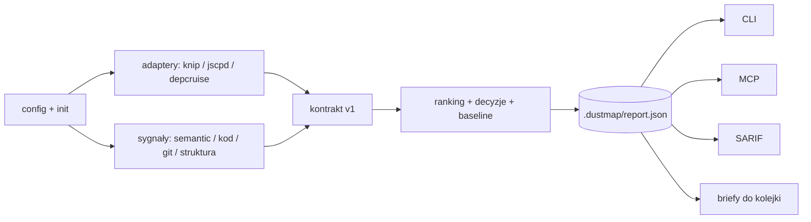

# DUST-00 — Dustmap: mapa kurzu w repo (tylko raport)

**Queue:** `DUST-00` | **Epic:** DUST | **Segment:** core | **Layer:** 0

## Overview

Dustmap skanuje całe repo albo same zmiany i zostawia **jeden raport**: martwy kod, duplikaty (tekstowe i po sensie), sygnały do przebudowy. **Nigdy nie zmienia kodu** — pokazuje, gdzie leży kurz, nie zamiata. Raport czyta agent AI (MCP / CLI) albo człowiek (markdown); eksporty (SARIF, briefy do kolejki) to wtyczki. Każdy podłącza go do swojego repo TS/JS jedną komendą.

Wizja: [docs/VISION.md](../VISION.md).

## Binding (decyzje epiku)

- **Report-only:** narzędzie zapisuje wyłącznie `outputDir` (domyślnie `.dustmap/`: raport, cache, decyzje, baseline). Zero edycji źródeł, zero auto-delete. Jedyne wyjątki, tylko na jawne polecenie: `init` tworzy config, `init --agent` wstawia bloki instrukcji dla agentów (DUST-17).
- **Agent-first:** głównym użytkownikiem jest agent AI. Każda odpowiedź mówi, co wywołać dalej; agent sam się wdraża z `dustmap_guide`; sukces mierzymy próbą prawdziwego agenta na Monorepo-A (DUST-18), nie tylko testami.
- **Prawdziwy kod jako miara:** od DUST-16 każda zmiana wyniku skanu jest mierzona na Monorepo-A i Service-B (tylko odczyt) względem ręcznie przejrzanego zbioru prawdy — [TEST-TARGETS](../TEST-TARGETS.md).
- **Owijka, nie fork:** Knip, jscpd (w tym `--semantic`), dependency-cruiser jako zwykłe zależności; każdy ma adapter → wspólny kontrakt.
- **Ogólne, nie pod jeden projekt:** wiedza o konkretnym repo (punkty wejścia, warstwy, wyjątki) żyje tylko w `dustmap.config.json` użytkownika.
- **Stały fingerprint znaleziska** (z treści kodu, nie numeru wiersza) — bez tego nie ma dedupe briefów ani pamięci decyzji.
- **Lokalnie i offline domyślnie:** embeddingi przez lokalny model. Sędzia LLM wyłączony domyślnie (DUST-14).
- **Sygnały, nie recepty:** raport mówi *gdzie boli i po czym widać*, nie *jak przebudować*.

## Epic plan

| ID | Outcome |
|----|---------|
| DUST-00 | Ten overview + szkielet repo (workspaces, kolejka, reguły agenta) |
| DUST-01 | Kontrakt raportu v1 (Zod): znalezisko, fingerprint, dowód, decyzje, mapowanie SARIF |
| DUST-02 | Rdzeń: konfiguracja, `init` (wykrycie frameworka + punkty wejścia), tryby `full` / `diff`, cache |
| DUST-03 | Adapter Knip — martwe pliki, eksporty, zależności |
| DUST-04 | Adapter jscpd — kopiuj-wklej po tokenach |
| DUST-05 | Podobieństwo po sensie — embeddingi, klastry „N funkcji robi to samo” |
| DUST-06 | Sygnały makaronu w kodzie — zawiłość, rozmiar, flagi, powtórzone warunki |
| DUST-07 | Sygnały z historii git — gorące miejsca, współzmiany, gęstość poprawek |
| DUST-08 | Sygnały struktury — graf importów, cykle, reguły warstw (dependency-cruiser) |
| DUST-09 | Ranking miejsc + plik decyzji + baseline / zapadka |
| DUST-10 | CLI `dustmap`: init / scan / summary / show / decide / export (md, SARIF) / ratchet |
| DUST-11 | Serwer MCP: podsumowanie, szczegół, zapis decyzji (limit odpowiedzi) |
| DUST-12 | GitHub Action + dowód na obcym repo + bramka licencji i izolacji |
| DUST-13 | Wtyczka „briefy do kolejki”: znaleziska → `queue.json` + brief markdown (dedupe) |
| DUST-14 | Opcjonalny sędzia LLM dla klastrów (domyślnie wyłączony) |
| DUST-15 | Pomiar: czy embeddingi znajdują coś sensownego na Monorepo-A (decyduje o DUST-05) |
| DUST-16 | Cele testowe: runner Monorepo-A / Service-B / self, migawki, zbiór prawdy, `verify:targets` |
| DUST-17 | Agent wpięty: playbook, `init --agent` (Claude / Cursor / Codex), `dustmap_guide`, pole `next` |
| DUST-18 | Próba prawdziwego agenta na migawce Monorepo-A; usterki → briefy |
| DUST-19 | Pierwsza komenda CLI: `scan` + `summary` (dopisane po DUST-03) |
| DUST-20 | Rola każdego pliku (źródło / test / generowany …) — dopisane po BUG-01 |
| DUST-21 | Filtr pewności w `dustmap_list` (z DUST-18) |
| DUST-22 | `dustmap list` w CLI — ta sama pętla bez MCP (z audytu) |
| DUST-23 | Żywy agent na migawce Monorepo-A — dokończenie DUST-18 (z audytu) |
| DUST-24 | Posprzątać kurz znaleziony w samym Dustmapie (z self-scanu) |

Kolejność startu: DUST-00 → DUST-01 i **równolegle DUST-15** (sam pomiar, bez kodu) → DUST-02 → DUST-16 → reszta.

## Architecture



## Plan

### Step 1 — Overview i binding

- **Plik:** ten brief + `docs/VISION.md`, `docs/architecture/*`
- **Zmiana:** decyzje epiku, mapa pakietów, niezmienniki produktu (report-only, jeden kontrakt, fingerprint).
- **Done when:** agent wie, czego nie wolno złamać, zanim powstanie pierwszy pakiet.

### Step 2 — Szkielet monorepo i kolejka

- **Plik:** `package.json`, `tools/queue/*`, `tools/tkr/*`, `tools/verify.mjs`, `docs/briefs/queue.json`
- **Zmiana:** workspaces `packages/*`, komendy kolejki (next / close / validate), bramka TKR, `verify` woła validate + self-test.
- **Done when:** `npm run verify` przechodzi; self-test łapie posadzone wady kolejki.

### Step 3 — Reguły agenta

- **Plik:** `AGENTS.md`, `docs/agent/RULES.md`, `docs/QUEUE.md`, `README.md`
- **Zmiana:** routing, język do maintainera, scope briefów, dowód CLI.
- **Done when:** `queue:next` / `queue:close` / `queue:validate` działają jako prawdziwe komendy npm.

## Constraints

- Zakaz tworzenia pustych paczek „na zapas” w `packages/` (pierwsza paczka = DUST-01)
- Zakaz łamania report-only w dokumentacji szkieletu
- Każda nowa bramka w `tools/` ma test negatywny (self-test)

## Pliki (scope)

- `package.json`, `README.md`, `AGENTS.md`, `docs/**`, `tools/**`

## Weryfikacja

```bash
npm run queue:validate
npm run queue:selftest
npm run verify
```

## Wyjście (acceptance)

- [x] Overview + binding + architecture map w `docs/`
- [x] Kolejka 19 zadań waliduje się; self-test łapie wady
- [x] `npm run verify` zielone przy 0 paczek produktu
- [x] Close bez `Fixes DUST-00` odmawia (TKR)
